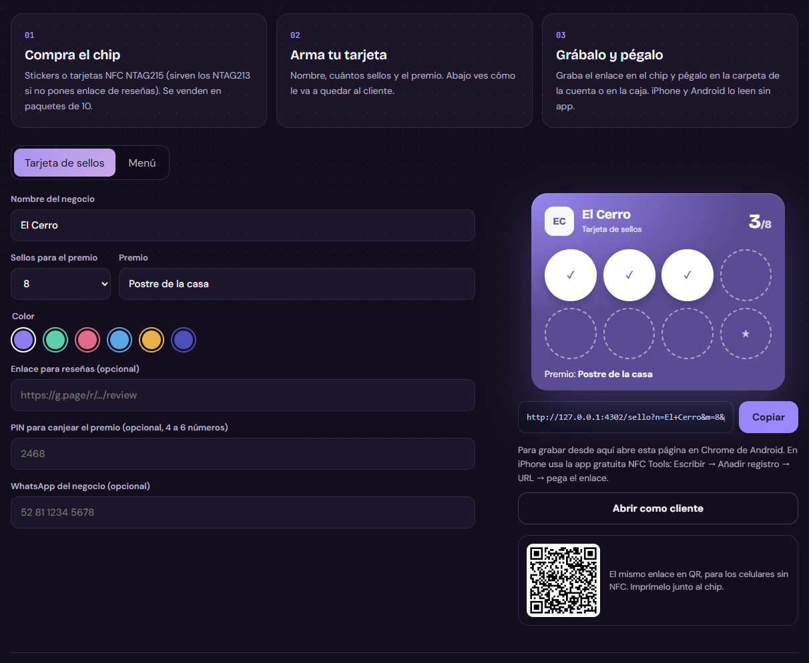

# NFC para negocios

[](https://github.com/Brunich/nfc-negocios/actions/workflows/ci.yml)

*Que vuelvan, sin quitarles tiempo.*

Una tarjeta de sellos en el celular, como la de cartón de cualquier café: cada visita suma uno y al completarla hay premio. Es para que el cliente vuelva y el negocio lo atienda mejor, y al cliente le cuesta un segundo: acercar el celular al chip.



**Pruébalo en vivo:** [bruno-portfolio-azure.vercel.app/proyectos/club-nfc](https://bruno-portfolio-azure.vercel.app/proyectos/club-nfc)

**App Android:** [descargar el APK](https://github.com/Brunich/Chip-NFC-Para-Empresas-Y-Negocios/releases/latest/download/nfc-negocios.apk). Graba y comprueba los chips con el lector NFC del teléfono, también los del menú, y un chip del negocio abre la tarjeta directo en la app.

## Cómo funciona

1. **Tap.** El cliente acerca su celular al chip de la cuenta o del mostrador. Se abre su tarjeta: sin app y sin llenar nada.
2. **Sello.** Suma uno por visita, máximo uno al día. Con la tarjeta llena, el premio que el negocio eligió: un postre, un café, un descuento.
3. **Vuelve.** Los sellos le dan una razón para regresar, y al negocio una forma de atenderlo: pedir su reseña o invitarlo de nuevo.
4. **Menú.** El mismo chip o un QR en la mesa abre la carta; el cliente arma su pedido y lo manda por WhatsApp.

## Qué hay adentro

| Archivo | Qué hace |
| --- | --- |
| `src/stamp-logic.ts` | Qué dice el enlace del chip (negocio, meta, premio, color), un sello por día y la huella del PIN de canje. |
| `src/Stamp.tsx` | La tarjeta que ve el cliente (`/sello`) y el armador del negocio, con QR y grabado por Web NFC. |
| `src/menu-logic.ts` | El menú viaja comprimido dentro del enlace (lz-string) y se calcula qué chip alcanza: NTAG213, 215 o 216. |
| `src/Menu.tsx` | La carta (`/menu`) con pedido por WhatsApp, y el editor del menú con número de mesa. |
| `src/ChipWriter.tsx` | Grabar el enlace en el chip y comprobar que quedó igual; dice por qué falló (NFC apagado, chip chico o bloqueado). |
| `src/native.ts` | Elige el lector: el nativo en la app, Web NFC en Chrome. En la app los enlaces llevan la página publicada. |
| `android/…/NfcChipPlugin.java` | Plugin propio de Capacitor: lee y graba NDEF con el modo lector de Android y relee lo grabado. |

La lógica está separada de la interfaz, así se prueba sin navegador (`tests/`).

## Decisiones

- Sin servidor: los datos del negocio viajan en el enlace que se graba en el chip, y los sellos viven en el celular del cliente.
- Un sello por día como máximo, para que no se pueda llenar la tarjeta en una sola visita.
- El PIN de canje no va en el enlace: sólo una huella SHA-256 atada al nombre del negocio.
- Cada enlace dice qué chip necesita: la tarjeta de sellos cabe en un NTAG213 (en un NTAG215 si lleva enlace de reseña); un menú que no cabe ofrece una versión sin descripciones para NTAG216, y el QR lleva el menú completo.
- En Android el chip se graba desde la app o desde Chrome con Web NFC; en iPhone se graba con una app como NFC Tools y se lee sin app.
- El cliente no necesita la app: el chip guarda un enlace normal. La app es para el negocio, y si un cliente la tiene, el chip la abre a ella en vez del navegador.

## Correrlo

```bash
npm install
npm run dev
```

```bash
npm test        # pruebas de la lógica (node:test)
npm run build   # tipos + build de producción
```

### App Android

```bash
npm run build
npx cap sync android
cd android && ./gradlew assembleRelease -PnfcKeystore=<ruta al .jks> -PnfcPassword=<contraseña>
```

La llave de firma no está en el repo. Sin `-PnfcKeystore` sale un APK sin firmar.

Hecho con React 19, TypeScript, Vite y Capacitor. Necesita Node 22 o más nuevo (las pruebas corren TypeScript directo con Node).

## In English

A stamp card and a digital menu on an NFC chip: customers tap their phone and the card opens, no app needed. Businesses set it up on the web or with the Android app, which writes and checks the chips with the phone's own NFC reader. React, TypeScript, Vite and Capacitor, with a small native plugin for NFC.

---

Parte del [portafolio de Bruno Salas](https://bruno-portfolio-azure.vercel.app) · [GitHub](https://github.com/Brunich)
